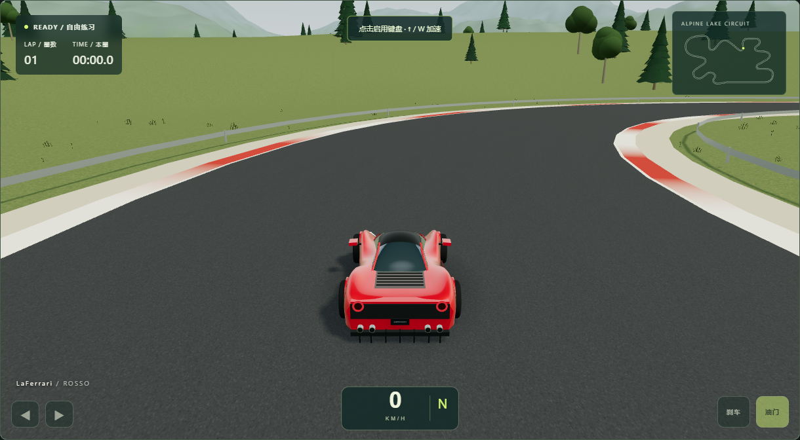

# Alpine LaFerrari Drive

一个正在打磨的第三人称浏览器赛车游戏。欢迎一起把车辆、赛道和风景做得更好！

An open-source third-person browser racer. Artists, 3D developers, and first-time contributors are welcome.

**[在线试玩](https://alpine-laferrari-drive-1118.greenspice5.chatgpt.site)** · **[参与美化](https://github.com/Shane060204/alpine-laferrari-drive/issues)** · **[贡献指南](CONTRIBUTING.md)**



## 欢迎参与

无论是一处材质、一盏车灯、一棵树，还是一张更清楚的操作提示，都欢迎提交 PR。也可以先在 Issue 中发设计草图或前后对比，讨论后再实现。

优先想改善的方向：

- **车辆造型与材质**：改善 LaFerrari 参考造型的曲面、轮拱、车灯、轮毂、玻璃、车漆和细节。
- **风景与光照**：更自然的山体、植被、岸线、水面、赛场建筑、阴影和远景层次。
- **驾驶体验**：转向、镜头、刹车手感、移动端操控和清晰的键盘焦点提示。
- **性能与无障碍**：降低绘制开销、优化手机体验，保留键盘可操作性。

找到感兴趣的 Issue 后留言认领，Fork 仓库，在自己的分支修改，然后提交 Pull Request。`good first issue` 适合从小处开始，`help wanted` 欢迎共同研究。

## 本地运行

需要 Node.js 20 或以上。运行和构建不需要安装依赖：

```sh
git clone https://github.com/Shane060204/alpine-laferrari-drive.git
cd alpine-laferrari-drive
node scripts/serve.mjs
```

打开终端显示的 `http://127.0.0.1:4173`。修改后重启该命令并刷新页面。

只生成可离线打开的 HTML：

```sh
node scripts/build.mjs
```

生成的 `dist/index.html` 包含全部代码和程序化素材，双击即可打开，也可以部署到任意静态网站托管服务。`dist/` 为构建产物，不纳入版本控制。

## 操作

先点击游戏画面中的“启用键盘”。

| 按键或按钮 | 功能                                   |
| ---------- | -------------------------------------- |
| ↑ / W      | 加速                                   |
| ↓ / S      | 刹车                                   |
| ← → / A D  | 转向                                   |
| 空格       | 暂停 / 继续                            |
| R          | 重新发车                               |
| 车辆展示   | 查看模型，拖动画面旋转，再点击返回驾驶 |

手机可按住画面中的转向、油门和刹车按钮。

## 合作与后续计划

欢迎讨论定制赛道、活动演示或交互展示等具体需求。可以先在[合作入口](https://github.com/Shane060204/alpine-laferrari-drive/issues/new?template=collaboration.yml)说明场景，再一起评估范围。项目计划见[路线图](docs/ROADMAP.md)。

## 源码入口

| 文件                      | 修改内容                                 |
| ------------------------- | ---------------------------------------- |
| `src/index.template.html` | 页面结构、SVG 小地图、赛道路径和仪表     |
| `src/styles.css`          | UI、响应式布局和触控按钮                 |
| `src/controls.js`         | 键盘与触控输入、驾驶状态、圈数和物理更新 |
| `src/environment.js`      | 灯光、地形、道路、植被、湖泊和建筑       |
| `src/vehicle.js`          | 程序化车身、车窗、轮毂、车灯和车辆材质   |
| `src/runtime.js`          | 第三人称镜头、模型展示、逐帧更新和 HUD   |
| `scripts/build.mjs`       | 合并源码，生成独立 HTML                  |
| `tests/browser.mjs`       | 浏览器输入及整圈路面穿插回归检查         |

渲染使用内置的 three.js r158，界面与小地图使用 HTML / SVG。当前模型和环境以程序化几何与材质生成，仍有很多值得打磨的地方。

## 验证修改

```sh
npm install
npx playwright install chromium
npm test
```

测试会构建页面、检查键盘驾驶、验证整车在第三人称画面内，并在整条赛道上检查 15960 个位置，避免草地地形再次穿过路面。无须测试时，不需要安装 Playwright。

视觉 PR 请附桌面和手机画面的前后对比。修改地形时，也请检查不同弯道，不能只看发车直道。

## 许可证与素材

项目原创代码以 [MIT](LICENSE) 许可证发布。three.js 的许可证保留在 [vendor/three/LICENSE](vendor/three/LICENSE)，其他说明见 [THIRD_PARTY_NOTICES.md](THIRD_PARTY_NOTICES.md)。

LaFerrari 为车辆造型参考；Ferrari / LaFerrari 名称及相关商标属于其各自权利人，本项目不表示官方关联。提交外部模型、贴图或音效时，请提供来源与适用的开源许可。
